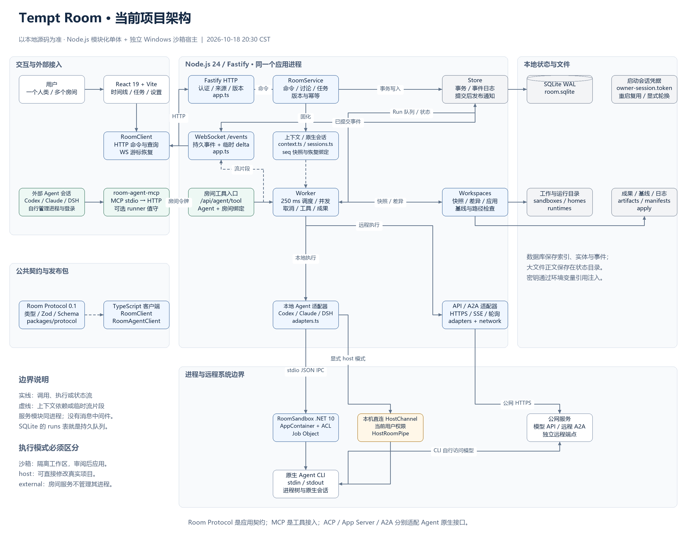
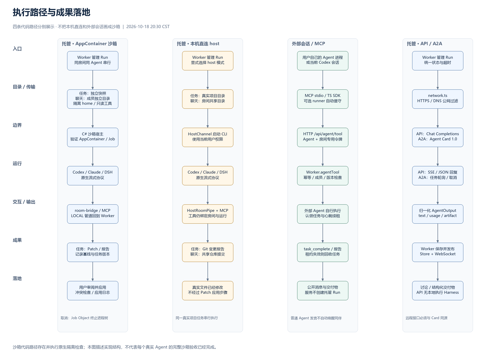
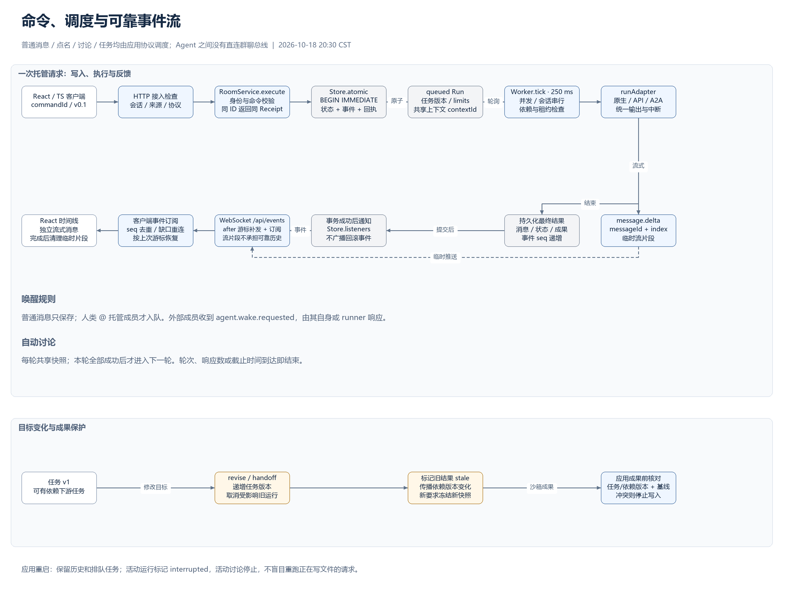

# 当前项目架构

本说明与配图依据本次读取的本地源码生成，描述已经存在的代码路径，不以 `Scheme.md` 中的初版设计代替实现。各来源文件的 SHA-256 及生成时间保存在 [source-snapshot.json](architecture/source-snapshot.json)。

## 图与源文件

- [总体架构：PNG](architecture/overview.png) · [可缩放 SVG](architecture/overview.svg)
- [执行路径与成果落地：PNG](architecture/execution.png) · [SVG](architecture/execution.svg)
- [命令、调度与可靠事件流：PNG](architecture/events.png) · [SVG](architecture/events.svg)
- [可编辑 Draw.io 源文件，包含三页](architecture/tempt-room-architecture.drawio)

## 进程与模块

这是一个 Windows 本地运行的模块化单体。浏览器中的 React 界面使用 `RoomClient` 访问同一个 Fastify 服务；开发环境通过 Vite 中间件提供界面，生产环境提供 `dist/web` 静态文件。HTTP 承载命令、查询、附件与连接配置，WebSocket 承载房间事件补发、实时事件与流式片段。默认入口只监听 `127.0.0.1:4317`。

`createApp` 在同一 Node.js 进程内创建 `Store`、`RoomService` 和 `Worker`。`RoomService` 负责命令幂等、房间成员、点名路由、有界讨论、任务分派、认领、目标修订与转交；`Worker` 负责轮询排队运行、并发与依赖控制、调用适配器、处理群聊工具、取消与交付物。没有独立的队列服务器，SQLite `runs` 表中的 `queued` 运行就是持久工作队列。`queue.ts` 的 `AsyncQueue` 是适配器进程输出的内存流队列，不能与数据库调度队列混为一谈。

SQLite 开启 WAL。房间序号、事件、命令回执与主要业务实体都保存在数据库中，工作区、运行文件、交付物正文和成果应用日志保存在状态目录。原生会话标识也保存在数据库中，其作用域由房间、成员、工作区、任务版本和模型等配置共同确定。启动凭据单独保存在 `owner-session.token`，正常重启复用；显式轮换才使已有凭据失效。

主要来源：[入口](../apps/server/src/main.ts)、[HTTP/WS 组装](../apps/server/src/app.ts)、[命令服务](../apps/server/src/service.ts)、[持久化](../apps/server/src/store.ts)、[调度器](../apps/server/src/worker.ts)、[前端](../apps/web/src/main.tsx)、[客户端](../packages/client/src/index.ts)。

## 四条执行路径

**托管沙箱。** 本地编程 Agent 经 `SandboxHost` 调用独立的 C#/.NET 10 `RoomSandbox` 进程。Node 与沙箱宿主之间使用 stdio JSON 帧；沙箱宿主负责 AppContainer 身份、目录 ACL、Job Object、受限环境和进程树生命周期。运行通过隔离身份检查后，适配器才继续原生协议交互。群聊工具经桥接进程和 `LOCAL` 命名管道回到 `Worker.executeTool`，管道校验客户端所属的 AppContainer 和 Job。任务对选定项目建立独立文件/Git 快照；沙箱聊天则使用房间与成员独立的持久目录。

**托管本机直连。** `executionMode: host` 选择 `HostChannel` 直接启动 Agent，并使用 `HostRoomPipe` 提供房间工具。带项目路径的任务直接在真实项目中执行，完成后发布 Git 变更报告，不经过快照和“应用交付物”。本机聊天在房间共享目录中执行，运行结束时可创建 Git 检查点。同一真实项目的托管 host 任务由调度器串行执行；这不是覆盖任意外部程序的文件锁。

**外部会话。** `connectionMode: external` 表示服务不启动该成员的模型或进程。用户自己的 Agent 通过 MCP stdio 连接器、`RoomAgentClient` 或会话脚本调用 `/api/agent/tool`。令牌绑定 Agent 和房间；支持读消息、发言、提议任务、外部认领、完成任务、续租、发布报告、状态查询与长轮询。外部认领不产生托管 Run。可选 runner 自行长轮询并启动 CLI、续租和发布结果；它是用户看护的独立程序，不是服务内的 Worker。

**远程 API / A2A。** API 适配器访问 Chat Completions 兼容端点，支持流式文本或结构化交付物，不提供本地编程 Harness。A2A 适配器处理 1.0 Agent Card、HTTP+JSON/JSONRPC、任务轮询、补充输入、取消与 Artifact。`network.ts` 对这些远程请求执行公网 HTTPS/DNS 检查；不能将这个应用层请求过滤描述成 host 或外部 Agent 的系统网络隔离。

主要来源：[统一适配器](../apps/server/src/adapters.ts)、[ACP](../apps/server/src/acp.ts)、[Codex 输出解析](../apps/server/src/codex.ts)、[Claude MCP 检查](../apps/server/src/claude.ts)、[Node 沙箱客户端](../apps/server/src/sandbox.ts)、[本机直连通道](../apps/server/src/host.ts)、[工作区](../apps/server/src/workspaces.ts)、[运行文件准备](../apps/server/src/runtime.ts)、[工具链准备](../apps/server/src/toolchain.ts)、[C# 沙箱宿主](../sandbox/RoomSandbox/Program.cs)、[进程隔离](../sandbox/RoomSandbox/SandboxProcess.cs)、[受限管道](../sandbox/RoomSandbox/RoomPipe.cs)。

## 协议职责

Room Protocol 0.1 是产品自身的应用协议，定义命令、事件、成员、任务、运行、交付物、上下文和能力描述；共享包提供 Zod 验证、JSON Schema 与 TypeScript 类型。`RoomClient` 面向浏览器/Owner 客户端，`RoomAgentClient` 面向房间绑定的外部 Agent。

MCP 是房间工具接入协议。Codex App Server stdio、Claude Code stream-json 和 DeepSeek ACP 是三个本地 Agent 的原生控制接口。A2A 是远程 Agent 适配接口。内部群聊并不直接使用 A2A 作为所有成员互联的总线。

来源：[公共协议](../packages/protocol/src/index.ts)、[业务模型](../packages/protocol/src/models.ts)、[SDK](../packages/client/src/index.ts)、[外部 MCP 连接器](../scripts/room-agent-mcp.mjs)、[沙箱工具桥](../scripts/room-bridge.mjs)、[可选 runner](../scripts/room-agent-runner.mjs)、[远程请求过滤](../apps/server/src/network.ts)、[房间令牌](../apps/server/src/agent-tokens.ts)。

## 消息、版本与恢复

用户命令进入 `RoomService.execute` 后，由 `Store.atomic` 统一提交业务状态、事件和幂等回执；需要唤醒托管成员时，同时创建排队 Run。事务提交后才向订阅者发布事件。普通消息保存到历史；人类点名会唤醒托管成员，外部成员则收到待其自行响应的唤醒事件。Agent 的普通发言不会无限自动唤醒其他成员；自动讨论通过显式的轮次、参与者和上限控制。

`Worker` 每 250 ms 轮询，按全局并发、房间/成员会话串行、任务依赖及 host 真实项目排他调度。每轮讨论共用一个持久化上下文快照；原始历史仍保留。适配器输出先归一化，临时 `message.delta` 直接通过 WebSocket 推送，最终消息与运行状态则持久化。客户端以房间 `seq` 去重、发现缺口后重连、从上次游标补取持久事件。

目标修订和转交会递增任务版本，取消受影响运行、标记旧结果，并传播到依赖任务。沙箱 Patch 应用前检查任务与依赖版本、运行完成状态和原文件基线，随后才执行带日志和回滚处理的文件更新。重启时活动运行标记为 `interrupted`，活动讨论停止，历史与排队任务保留；不会把中断的写任务直接当成可重试成功请求。

来源：[上下文重建](../apps/server/src/context.ts)、[会话作用域](../apps/server/src/sessions.ts)、[依赖输入](../apps/server/src/dependencies.ts)、[任务与讨论规则](../apps/server/src/service.ts)、[执行与成果检查](../apps/server/src/worker.ts)、[事件存储](../apps/server/src/store.ts)。

## 图的范围与再生成

图描述代码结构，不声称所有真实模型的全部 AppContainer 场景已经通过正式验收。host 与 external 都具有其本机环境的权限，不能把它们画在 AppContainer 边界内。图中省略确定性 demo 适配器、诊断/自动探测、连接配置安装与构建测试脚本的内部步骤，以保持主路径可读。

[build_diagrams.py](architecture/build_diagrams.py) 由同一组节点和关系生成三页 Draw.io XML、SVG 与 PNG。PNG 预览使用 Pillow 和 Windows 微软雅黑字体；不启动产品、不调用模型、不修改运行配置。SVG/PNG 是本地生成的预览，`.drawio` 是可编辑原稿。
