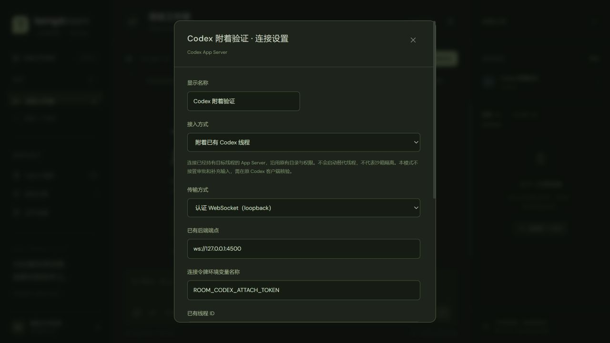

# Codex 原生线程接入 Room：研究与探测结果

研究日期：2026-10-18，Windows，Codex CLI `0.163.0-alpha.10.2`。本次目标是让 Room 调度当前已有的 Codex 会话，而不仅是启动另一个同模型的 Agent。

## 已实现的 attach 接入（2026-10-18）

下面的研究记录保留原始探测背景。现在代码已经实现独立的附着适配器，尚未将当前桌面线程切换为 attach：当前桌面后端仍没有经过验证的共享入口。

在「Agent 连接」里选择 Codex，将「接入方式」设为「附着已有 Codex 线程」，填写已有后端端点、认证环境变量名、线程 ID、线程实际工作目录和可选固定版本，然后「保存并诊断」。配置使用 `connectionMode: "attach"`，与托管启动、外部 MCP 并列；执行模式必须为 `host`。这里不使用模型 API 地址，也不导入账号凭据或更改线程模型、权限、工作目录、MCP 配置。

配置示例（端点和线程必须换成目标后端真实值）：

```json
{
  "id": "codex-attached",
  "name": "已有 Codex",
  "provider": "codex",
  "enabled": true,
  "connectionMode": "attach",
  "executionMode": "host",
  "version": "0.163.0-alpha.10.2",
  "codexBinding": {
    "transport": "websocket",
    "endpoint": "ws://127.0.0.1:4500",
    "credentialEnv": "ROOM_CODEX_ATTACH_TOKEN",
    "threadId": "替换为已有线程ID",
    "expectedCwd": "D:\\Projects\\your-project"
  }
}
```

WebSocket 只接受 `127.0.0.1` 或 `[::1]` 的端点，要求通过环境变量提供 Bearer 能力令牌；不接受 URL 内嵌凭据、查询令牌或跳转。另提供 `control-socket` 传输：`endpoint` 填 socket 绝对路径，`executable` 填 Codex 绝对路径，由 `codex app-server proxy --sock <path>` 转接。本机缺少桌面控制 socket，因此该传输只完成了连接失败路径核验，不能报告为真实桌面附着成功。

如果设置了 `ROOM_CODEX_ATTACH_TOKEN`，应使其存在于 **Room 服务启动进程** 的环境中；仅在另一个终端设置不会更新已运行服务的环境。这里只保存变量名，不保存或向浏览器返回原始令牌。此令牌是后端连接令牌，不是模型 API key。

执行行为：

- 每次运行先校验后端版本、loaded 列表、线程状态和 cwd。历史可读但未加载时拒绝执行，不调用 `thread/resume`、`thread/start` 或 fork。
- 在队列写入之前持久化请求意图，随后保存原生队列标识和轮次标识。稳定的 `clientUserMessageId` 以 Room runId 构造。
- Codex 本身可能自动消费队列；本机真实 CLI 已观察到该行为。适配器处理“队列项已消费、轮次尚未落盘”的短暂窗口，并用 userMessage 的 `clientId` 找到自己的轮次。若队列项仍在且线程空闲，才对明确的 `queuedSubmissionId` 调用 `thread/queue/start`，不启动其他客户端的队首项。
- 同一 threadId 在所有房间、所有成员及端点别名间串行调度。状态未知的旧运行会阻止该线程继续接受 Room 执行，直至核对确认结束。
- 输出严格匹配线程和轮次；只发布 agentMessage 正文，不公开 reasoning、其他轮次或其他线程。流式通知之外还读取完整轮次来确认终态；不会为了订阅而 resume 现有线程。
- 取消只删除本次排队项或中断本次轮次，等待停止证据。收到 interrupt 回执而轮次仍在运行时，保持“状态待核实”。连接断开、Room 退出都不会终止已有 App Server。
- 服务重启保留原生请求标识，将有写入意图的运行标记为 unknown，不自动重发。界面提供「核对状态」和「核对并停止」；后者也只操作已记录的队列/轮次。
- 附着不创建项目快照、不切换原线程目录、不自动提交其 Git 文件，也不会生成可应用到其他项目的补丁。任务指定了不同项目目录时拒绝执行。
- 当前附着适配器不接管原客户端的审批、补充输入、动态工具或 usage 统计，能力声明对应为 false。依赖这些交互的真实线程需要单独验收；不能假定原客户端一定收到由附加客户端触发的请求。

核对 API（使用已有 owner 会话认证）：

```http
POST /api/runs/<runId>/codex/reconcile
Content-Type: application/json
Room-Protocol-Version: 0.1

{"cancel": false}
```

返回 `location`（queued / turn / missing / canceled）、`phase` 和最新 Run。查询只做读取；`cancel: true` 才尝试停止归属于该 Run 的原生工作。队列仍在或轮次还活跃时维持 unknown，**不会自动启动、重发或把请求恢复成新的执行**。查到终态时补发最终正文并结束 Room Run；无法证明归属时保留 unknown。TypeScript 客户端提供 `RoomClient.reconcileCodex(runId, cancel)`。

验证方式：

```powershell
# 模拟后端的调度、取消、断线、重启等回归，不请求模型
npm run test:codex-attach

# 对用户指定的已有后端进行只读检查，不创建或恢复线程
npm run codex:check-attach -- --endpoint ws://127.0.0.1:4500 --thread <threadId> --cwd D:\Projects\your-project

# 真实本机 CLI + 临时 CODEX_HOME + 本地 Responses 模拟服务，不访问付费模型
npm run test:codex-attach-native -- --codex <codex.exe绝对路径>
```

真实原生探测已在 CLI `0.163.0-alpha.10.2` 上通过：创建脚本自有测试线程，由第二个客户端附着，原生队列进入一个完整轮次，得到 `NATIVE_ATTACH_FIXTURE_OK`；客户端断开后后端仍活着，脚本最终只清理自己启动的后端。该次结果位于 `.state/codex-attach/native/probe-FpKztN/report.json`，真实模型请求为 0，本地模拟 Responses 请求为 1。最终完整回归 125/125 通过（附着专项 20 项），类型检查、生产构建、SDK/JSON Schema 生成及凭据扫描通过。它验证实际 Codex 协议互操作，不能替代当前桌面后端或真实账号/模型的验收。

主要实现：[codex-attach.ts](../apps/server/src/codex-attach.ts)、[独立连接通道](../apps/server/src/codex-attached-channel.ts)、[协议配置与运行状态](../packages/protocol/src/codex.ts)、[测试](../tests/codex-attach.test.ts)。



## 结论

Room 内当前 Codex 发言已经使用 `actor.kind: agent`。欠缺的是当前线程的自动唤醒、排队、输出关联和生命周期控制，而不是消息作者身份。

原生接入应复用 Codex App Server JSON-RPC。现有托管适配器已经支持启动 Codex App Server；已有线程绑定则需要新的附加通道，不能把当前外部成员简单改成 `managed`，也不能把“另一个 App Server 读取到了同一个 threadId”当成接管成功。

本机桌面后端在探测时由桌面应用通过 stdio 启动，没有发现该进程的 TCP 监听端点；默认 `~/.codex/app-server-control/app-server-control.sock` 不存在。官方 `app-server proxy` 连接该默认 socket 失败。因此，当前还没有验证出能附加到这个桌面后端的共享控制入口。

这不等于 Codex 不能被 Room 原生托管，也不证明所有桌面版本永远不能附加；它限定的是本机、本版本、这次探测所观察到的连接方式。

## 本次实际验证

所有探测均未发送模型请求，未调用 `thread/start`、`thread/resume`、`thread/queue/add`、`thread/queue/start`、`turn/start` 或中断当前线程；未修改用户登录与桌面启动配置。临时后端只清理本次脚本自己创建的进程。

- **独立 stdio 后端读取成功。** `initialize`、`thread/loaded/list`、`thread/read` 都成功。能够读取当前线程的元数据，但新后端的 loaded 列表为空，目标状态为 `notLoaded`，读取后仍未加载。
- **默认控制 socket 不可用。** `app-server proxy` 无法连接默认路径。这条路径的握手失败，不能把它报告为已接入。
- **带认证的本地 WebSocket 后端可用。** 使用临时 loopback 地址和内存中的随机能力令牌，未经认证的握手被 401 拒绝，带 Bearer 凭据的握手及读取接口成功。原始令牌未写入报告或文件。
- **已有线程校验有效。** `--require-loaded` 对“仅能读取历史但未拥有该活动线程”的新后端返回失败，没有自动执行 resume 或启动替代线程。
- **原生排队读取可用。** 当前安装版本生成的 Schema 包含 `thread/queue/add/list/update/delete/reorder/start`。已实际调用 `thread/queue/list`，得到正常响应；没有写入任何排队消息。队列写入、自动启动、跨进程通知与模型轮次尚未验收。

原始证据位于 `.state/codex-attach/`：`standalone-read.json`、`proxy-read.json`、`ws-read.json`、`live-attachment-guard.json`、`queue-read.json`；这些是诊断数据，不作为应用配置。

## 两种不同的交付目标

**固定的 Room 托管 Codex。** 继续使用现有 `managed` 路径，给房间保存自己的原生 threadId，并由 Room 统一调度。这个方案能够自动响应 @、参与有界讨论和执行任务，使用 Room 自己的上下文。它是独立会话，即使模型、账号和项目相同，也不能宣称是当前桌面会话。

**附加当前桌面线程。** 必须先得到拥有该活动线程的后端的可连接入口，或使用经过验证的官方桌面控制桥。如果最终只有存储历史而没有实时后端连接，产品应显示“可读取历史，未连接活动会话”。当前端点条件未满足，不应继续进行强制加载或接管。

也可以设计显式交接：在用户确认释放原线程的运行所有权后，由 Room 恢复存储的线程。但“交接后续写历史”与“同时控制仍在桌面运行的当前实例”是不同的产品能力；本次没有测试交接。

## 拟议接口与数据

建议为 Codex 增加单独的线程绑定配置，而不是复用远程 A2A 的 `endpoint` 字段：

```ts
type CodexThreadBinding = {
  backendMode: 'spawn' | 'attach';
  transport: 'stdio' | 'websocket' | 'control-socket';
  endpoint?: string;
  credentialEnv?: string;
  threadId?: string;
  expectedCwd?: string;
};
```

`attach` 的执行模式应明确为已有宿主会话，不能显示为 AppContainer 已验证。配置只保存端点、线程标识和凭据变量引用，不复制 ChatGPT 登录文件。

每次绑定应验证后端版本、认证、目标线程的存在、当前加载状态与工作目录。需要当前活动实例的场景，必须检查该线程已经加载在目标后端；否则拒绝绑定，不能静默新建、fork 或通过另一个进程 resume。只提供历史读取时不通过执行就绪检查。

## 调度与生命周期

Room 仍保存自己的 Task、Run、目标版本、contextId 和命令回执；额外保存后端/线程绑定、`queuedSubmissionId`、`clientUserMessageId` 和 `nativeTurnId`。线程的并发锁必须按 `(backend, threadId)` 全局控制，不能只沿用 `(roomId, agentId)`，否则一个线程加入多个房间后可能被同时调度。

计划的调用顺序为：Room 创建 Run → 为消息构造稳定的 `clientUserMessageId` → `thread/queue/add` → 记录 `queuedSubmission.id` → 确认线程空闲和调度权 → `thread/queue/start` → 记录返回的 `turn.id` → 消费本线程、本轮次的输出 → 完成 Room Run。忙碌时保留排队，默认不使用 `turn/steer` 改写用户当前任务。

当前 Schema 中 `ThreadQueueAddParams` 必填 `threadId`、`input`、`clientUserMessageId`；`ThreadQueueStartParams` 接收 `threadId` 和可选 `queuedSubmissionId`。`ThreadQueueStartResponse` 返回 Turn。这里只确认字段，不推断 `clientUserMessageId` 已提供完整的网络重试幂等保证；该语义需要通过受控写入与断线测试验证。

只有同时匹配绑定 threadId 和 Room 自己记录的 turnId 的正文与事件，才能发布到对应房间。其他桌面轮次的内容、隐藏推理和其他线程的输出不应进入房间。审批及补充输入请求同样要检查归属。

取消排队 Run 时，只移除 Room 自己的排队项；取消运行中的 Run 时，只发送其 `turn/interrupt` 并等待该轮次终止事件。断开附加连接、超时或服务退出时，不能终止桌面后端进程。

现有 `nativeRun` 的 finally 会调用 `channel.terminate()`，本机 `HostChannel.terminate()` 会终止整个子进程树。因此附加模式必须使用独立的 `AttachedCodexChannel`/控制器，不可直接套用已有进程所有权逻辑。

附加时不应沿用托管适配器中对 `cwd`、`approvalPolicy: never` 和 `externalSandbox` 的覆盖。这些选项可能改变既有线程后续轮次的行为；附加控制器应保留线程自身设置，并在绑定时校验目录一致。

收到发送回执前断线时，将 Run 标记为待核对，重连后查询排队项和轮次历史。不能因为连接断开就自动重新执行一次写任务。`thread/queue/add` 的成功也只能表示进入队列，不能直接显示“正在执行”或“已完成”。

## 下一阶段验收

先补附加连接的只读就绪检查和全局线程绑定，不改变当前房间成员。获得目标后端控制入口后，再在明确选定的测试线程上验证队列写入、空闲启动、增量输出、最终回帖、忙碌排队、人工补充输入、取消、断线恢复以及 Room 退出不影响桌面后端。

真实模型验证应与只读探测分开，显式运行；在同一轮同时从桌面和 Room 发起输入的冲突规则需先确定。WebSocket 接口在官方文档中仍标为 experimental，产品接入应固定已验证版本并提供能力诊断。

## 复现只读探测

```powershell
node scripts/probe-codex-attach.mjs --codex '<codex.exe绝对路径>' --thread '<当前threadId>' --out .state/codex-attach/standalone-read.json

node scripts/probe-codex-attach.mjs --codex '<codex.exe绝对路径>' --thread '<当前threadId>' --transport proxy --out .state/codex-attach/proxy-read.json

node scripts/probe-codex-attach.mjs --codex '<codex.exe绝对路径>' --thread '<当前threadId>' --transport ws --require-loaded --out .state/codex-attach/live-attachment-guard.json
```

第三条命令会启动带认证的临时 loopback 后端，用于证明历史可读与当前实例绑定的差别；在新后端中当前线程未加载时，预期退出失败。它不是用于把桌面已有线程迁入临时后端。

脚本只允许 `initialize`、`thread/read`、`thread/loaded/list`、`thread/queue/list` 四个读取/握手方法，以及 `initialized` 通知；不写入聊天或队列。报告只保存目标线程元数据和通知计数，不保存对话正文或认证令牌。

## 依据

- [OpenAI App Server 文档](https://learn.chatgpt.com/docs/app-server)：传输、WebSocket 认证、线程读取、加载状态、轮次控制与输出事件。
- [OpenAI CLI 文档](https://learn.chatgpt.com/docs/cli/reference)：已有线程排队及 App Server 连接方式。
- 当前安装的 CLI 实际执行 `app-server generate-json-schema --experimental` 所生成的 Schema，位于 `.state/codex-attach/schema/`。
- 本项目 [adapters.ts](../apps/server/src/adapters.ts)、[worker.ts](../apps/server/src/worker.ts)、[host.ts](../apps/server/src/host.ts) 与 [sessions.ts](../apps/server/src/sessions.ts)。
