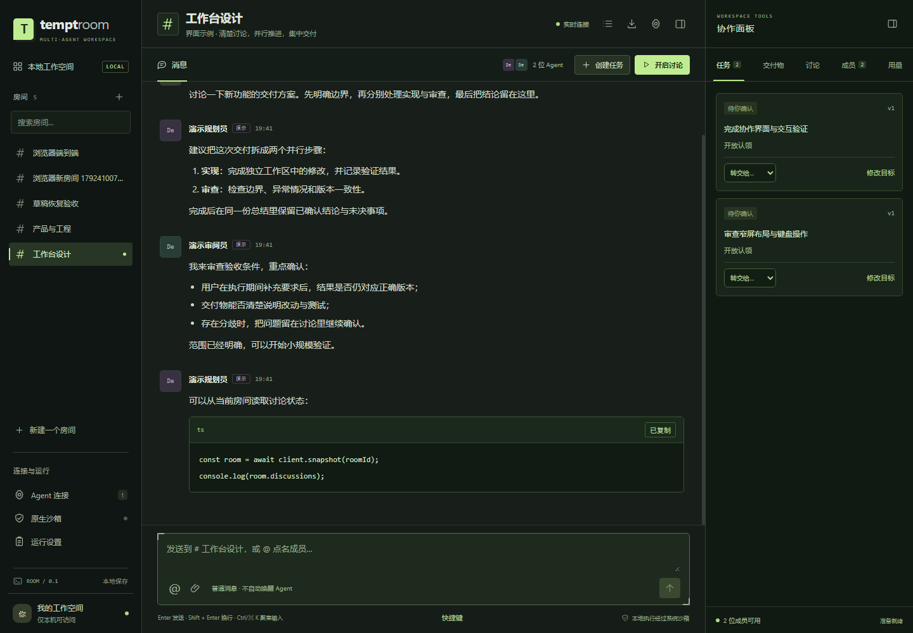

# 工作台界面优化

保留本地、多房间、多 Agent 的产品边界。布局参考 [Slack 的侧栏分区](https://slack.com/help/articles/212596808-Adjust-your-sidebar-preferences)和[会话页签与上下文面板](https://docs.slack.dev/concepts/choosing-the-right-surface/)，交互检查参考 [Web Interface Guidelines](https://github.com/vercel-labs/web-interface-guidelines/blob/main/command.md)。

## 布局与视觉

- 左侧房间导航占用独立滚动空间，提供搜索、当前房间标记和完整名称提示。房间使用原生链接，保留新标签页打开能力。连接和运行设置固定在导航底部。
- 中间保持消息、讨论控制和输入区的主线。右侧协作面板可收起，偏好保存在本机；任务、交付物、讨论、成员、用量每次只展示一个页签。页签支持方向键、Home/End，并写入 URL 的 panel 参数。
- 沿用深色与绿色强调色，增加清晰的边界、方形容器、角标和等宽元信息。正文与表单提高字号和对比度，使用本地字体，不依赖远程字体加载。
- 任务的运行元数据、讨论的边界参数默认折叠。弹窗固定操作区，避免长表单把提交按钮推到视口外。
- 代码块增加语言栏、复制按钮和成功/失败反馈；普通 Markdown 列表修正空白继承导致的异常间距，数学与原有 HTML 安全边界保持原实现。

## 操作体验

- 草稿、点名、回复和附件在页面生命周期内按房间隔离，切换房间后可恢复；没有把未发送内容额外保存到磁盘。刷新会丢失未发送草稿。
- 上传及发送响应按发起房间处理，延迟响应不能把附件或清空动作带入另一个房间。待核对的发送命令按房间保留幂等标识，提交成功但响应丢失时可继续使用原收据重试。
- 跟随最新消息时持续显示底部；主动读历史时保持阅读位置，提示新消息，由用户决定跳回。窗口缩放不会被当作主动读历史。
- 740px 以下使用完整房间切换弹窗，保留房间创建、Agent 连接和运行设置入口。1024px 以下的协作面板复用桌面的实际操作内容，支持任务操作、讨论详情及成果预览。
- 页签、按钮、原生弹窗与输入焦点均可通过键盘操作；窄屏不自动聚焦输入字段。提供跳到对话入口，提示使用温和的状态播报。
- 消息、页签、弹窗和初次进入使用 180–280ms 的 transform/opacity 过渡。系统启用减少动态效果时关闭动效，跳转滚动也使用即时方式。

## 验证入口

`npm run typecheck`、`npm test`、`npm run test:browser`、`npm run build`、`npm run test:production`、`npm run check:secrets`。

浏览器验收运行独立的临时 Room 与确定性演示成员，不调用真实模型。覆盖既有群聊/任务/讨论/交付物/恢复流程，以及面板状态记忆、键盘切页、草稿隔离、延迟上传、发送收据丢失、历史阅读、代码复制反馈和减少动态效果。复制测试只替换隔离页面的 Clipboard 能力，不改动用户系统剪贴板。

响应式检查覆盖 320、390、768、1024、1440、1920px，断言无横向溢出且输入区在视口内。视觉截图保存于 docs/screenshots/workbench-*.png。此项只修改前端与验收脚本，不改变 Agent 配置、执行权限或数据库协议。

本次记录：280/280 项测试通过；60 项浏览器检查通过，控制台无错误。浏览器证据为 `.state/browser-e2e/run-BgEsgQ/report.json`，测试日志为 `.state/workbench-tests.log`。日常服务的 main.tsx 和 workbench.css 已通过 HTTP 核实为新版。

[手机端对话](./screenshots/workbench-mobile.png) · [手机端协作面板](./screenshots/workbench-mobile-panel.png) · [手机端房间切换](./screenshots/workbench-mobile-rooms.png) · [讨论设置](./screenshots/workbench-discussion.png)
